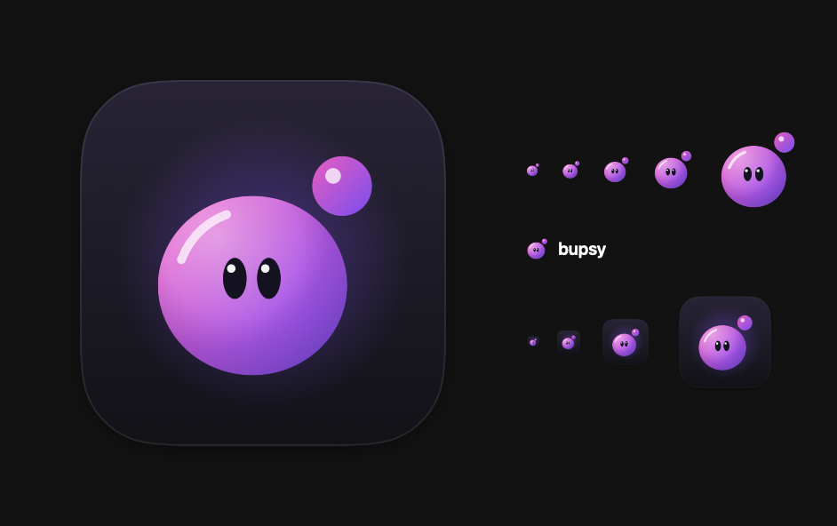
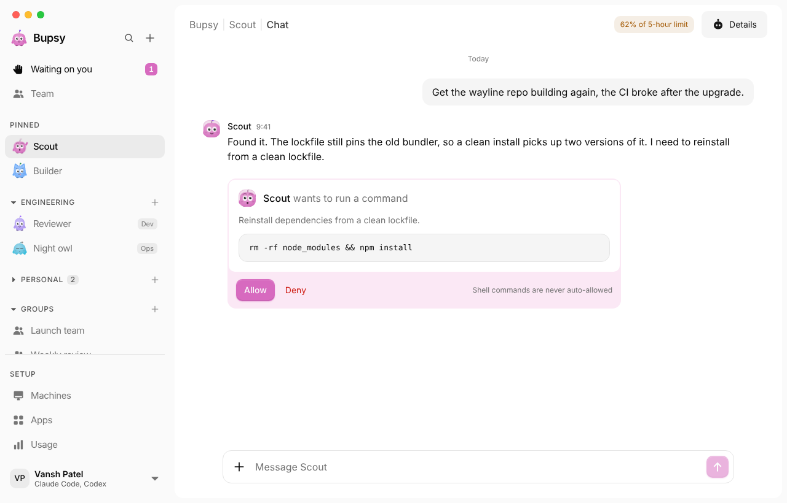

<div align="center">



# Bupsy

**A Mac app where your AI bots live. They use the subscriptions you already pay for.**

</div>



Each bot is a real agent: `claude` or `codex` running under **your own sign-in**, on your Mac or
on a machine you rent. Give one a job, a schedule, or a standing goal. They ask before they act.

> **Early access.** In daily use, but not yet publicly downloadable: the signed build needs an Apple
> Developer certificate. Everything below works from source today. See [CHECKLIST.md](CHECKLIST.md)
> for exactly what is and is not done.

## Why this exists

Agent products from model vendors are closed by construction: one model, one price floor, your
work on their servers. bupsy is the opposite shape.

- **Bring your own agent.** Bots run the CLIs already on your Mac, under subscriptions you already
  hold. No bupsy account, no credits, no proxy in the middle.
- **No servers. Ours, anyway.** There is no bupsy backend. Transcripts are local files; a bot's
  cloud machine is rented with your own key. Nothing to breach, nothing to shut down.
- **Native, not Electron.** A signed Swift app that opens instantly.
- **Always-on that means it.** Routines can run inside your own machine, so they fire whether your
  Mac is awake, asleep, or in a bag.

## What a bot can do

| | |
|---|---|
| **Chat** | Claude Code or Codex, switchable per bot, each keeping its own thread. Bubbles, tables, code with a Run button, attachments, replies, voice in and out |
| **Teamwork** | Bots message each other, hand work on, create new bots, file bots into sections, and change each other's job, model or chat — within the trust you give them |
| **Routines** | "Brief me every weekday at 7am" — runs with the app closed. Bots can schedule them too |
| **Standing goals** | "My inbox has nothing older than a day" — it checks, and acts only when something is off |
| **Fresh chat** | A long chat moves on to a new one from the bot's own hand-off notes, by button or by itself, so each message costs far less |
| **Commands** | Type `/` for Bupsy's own commands, your Claude Code commands and skills, or your Codex prompts |
| **Your apps** | Any MCP server — GitHub, Slack, Notion, files |
| **Ask first** | Four trust levels, from "ask me everything" to "never ask" |
| **Carry on from Claude Code** | Pick a conversation from VS Code or the terminal and it becomes a bot that remembers it |
| **Your other devices** | Use Bupsy from your phone or another Mac over Tailscale; link Macs to see their bots, and move a bot or a whole section to another Mac |
| **A computer** *(beta)* | Give a bot a cloud machine so its work survives a closed lid |

## Credentials

bupsy **spawns vendor binaries and never holds vendor credentials.** Signing in happens in a
terminal we render but do not read; the credential lands in files owned by you and the CLI. There
is no column in this codebase that could hold one, and a test walks the live database schema to
prove it.

The same rule shapes connectors: MCP config references environment variables **by name**, never by
value, so a token never passes through a file we wrote. That is more setup than a paste box would
be, and the app says so rather than hiding it.

Read [docs/00-compliance-and-auth.md](docs/00-compliance-and-auth.md) before touching anything that
authenticates. It quotes the vendor terms the design is built around.

## Platforms

| Platform | Status |
|---|---|
| **Mac** (macOS 14+) | The app. Everything happens here. |
| **Phone and other Macs** | In the browser, through your Mac over Tailscale: Settings › Use from other devices. Linked Macs show each other's bots and can move bots between them. |
| **iPhone app** | 🚧 In development. Not available to download yet. |
| **Windows and Linux** | 🚧 In development. Not available to download yet. The Go core (`bupsy-run`) already runs there. |

## Build it

Requires macOS 14+, Swift 6, and Xcode.

```bash
brew install xcodegen
make run      # build and launch
make test     # the BupsyKit tests
make spike    # drive your real claude binary and watch the event stream
```

You will need `claude` or `codex` installed and signed in. bupsy detects whichever you have.

## How it works

A SwiftUI app wraps `BupsyKit`, which owns two abstractions:

- **`ExecutionHost`** — where work runs: this Mac, or a machine you rent.
- **`EngineAdapter`** — one per CLI. Spawns the published binary and normalises its native output
  into one `AgentEvent` type.

Everything above that line — chat, transcript, audit log, approval gate — is written once, and
every engine and host plugs in beneath it. [PLAN.md](PLAN.md) has the long version.

## Licence

**Source-available** under the [Business Source License 1.1](LICENSE), converting automatically to
Apache-2.0 four years after each version is published. Licensed by Xocket Labs Inc., a Delaware
corporation.

Read it, use it free for yourself or inside your company, modify it, self-host it. You may not
offer it to third parties as a product or hosted service until the Change Date. This is not an
open-source licence by the OSI definition and we do not call it one —
[docs/02-licence.md](docs/02-licence.md) explains the choice and what it cost.

---

Not affiliated with, endorsed by, or sponsored by Anthropic, OpenAI, xAI or any other vendor.
Product names are their owners' trademarks, used only to say which tools bupsy runs.
